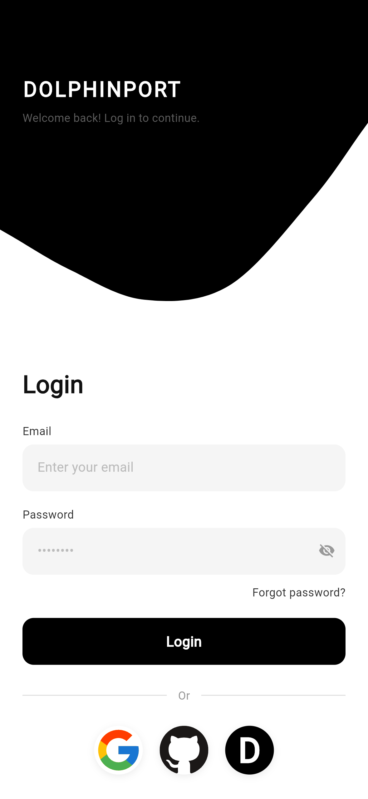
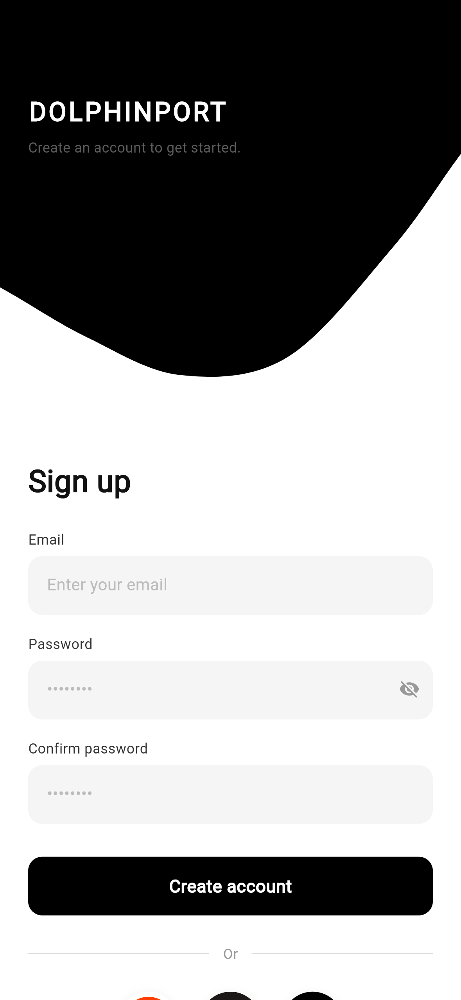
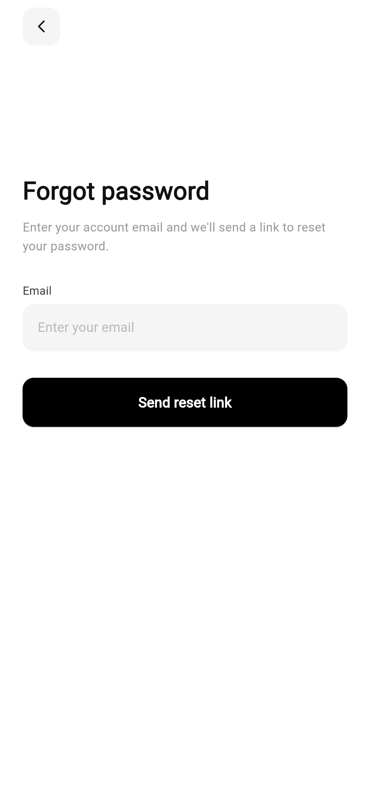
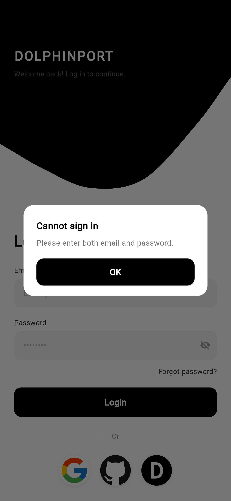
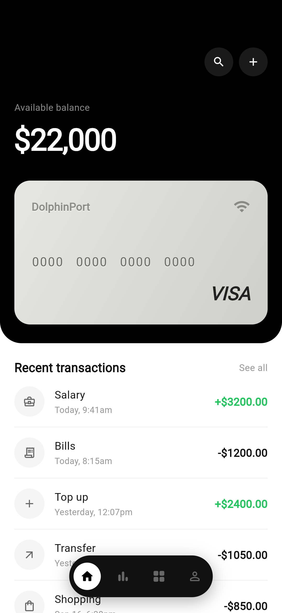

# DolphinPort

[](LICENSE)
[](https://flutter.dev)
[](https://www.android.com)

> Smart finance, in your pocket.

**DolphinPort** is an Android-only digital wallet front-end built with
Flutter. It reproduces the look and feel of a modern payment application —
signing in, viewing a balance and a payment card, browsing transactions and
exploring analytics — entirely on the device. It is intended for learning,
interface exploration and demonstration rather than for real financial use.

The project deliberately targets **Android only**. There is no iOS, web or
desktop configuration, and no back-end is required: every balance,
transaction and chart series comes from deterministic, in-memory data.

## Features

- **Authentication flow** — splash, login and sign-up, password recovery and
  third-party quick login (demo only).
- **Home dashboard** — animated available balance, a silver payment card and
  recent transactions.
- **Card security** — the card number is masked and revealed only after a
  password or the system-provided biometric check.
- **Transactions** — the complete list with working Today, This week, This
  month, This year and Custom date-range filters, plus a live income and
  expense summary.
- **Analytics** — bar, line and pie charts with income and expense filters
  and category rankings.
- **Rust back-end placeholder** — a reserved crate for a future
  administrative and security service.

## Screenshots

| Login | Sign up | Forgot password |
| ----- | ------- | --------------- |
|  |  |  |

| Error dialog | Home |
| ------------ | ---- |
|  |  |

## Requirements

- Flutter 3.44 (stable) with Dart 3.12 or newer
- JDK 17
- Android SDK with platform 37 and build tools 37.0.0
- A device or emulator running Android 7.0 (API 24) or newer
- Rust 1.80 or newer (only needed for the placeholder service)

## Getting Started

```bash
# Fetch the dependencies
flutter pub get

# Run on a connected Android device or emulator
flutter run --release
```

Any non-empty email address and password will sign you in to the demo.

## Building the APK

```bash
# Debug build
flutter build apk --debug

# Release build for arm64 devices
flutter build apk --release --target-platform android-arm64
```

The release APK is written to
`build/app/outputs/flutter-apk/app-release.apk`. Release builds enable R8
minification and resource shrinking; the keep rules live in
`android/app/proguard-rules.pro`.

### Signing a release

Release signing is read from `android/key.properties`, which is kept outside
version control:

```bash
cp android/key.properties.example android/key.properties
# Edit android/key.properties with your keystore details
```

When `key.properties` is absent, the release build falls back to the debug
signing configuration, so continuous integration can still verify the
release pipeline. See [docs/BUILD_AND_RELEASE.md](docs/BUILD_AND_RELEASE.md)
for the complete release process.

## Project Structure

```
DolphinPort/
├── android/             # Android host application, signing and icons
├── lib/
│   ├── app/             # Application widget, theme and centralised routes
│   ├── core/            # Cross-cutting constants
│   ├── data/            # Repositories and the data boundary
│   ├── models/          # Domain models and the in-memory data source
│   ├── screens/         # Feature screens (auth, home, transactions, charts)
│   └── widgets/         # Reusable widgets
├── rust/                # Placeholder administrative/security service
├── test/                # Unit and widget tests
├── integration_test/    # Integration smoke tests
├── docs/                # Architecture and platform documentation
└── screenshots/         # Images used by this README
```

See [docs/ARCHITECTURE.md](docs/ARCHITECTURE.md) for the layering, routing
and data-flow details.

## Documentation

- [Architecture](docs/ARCHITECTURE.md)
- [Platform support](docs/PLATFORM_SUPPORT.md)
- [Build and release](docs/BUILD_AND_RELEASE.md)
- [Contributing](CONTRIBUTING.md)
- [Code of conduct](CODE_OF_CONDUCT.md)
- [Security policy](SECURITY.md)
- [Changelog](CHANGELOG.md)

## Roadmap

The `rust/` crate is a placeholder for a small service that may later provide
an administrative console, security helpers such as short-lived token
minting, and brief, on-demand data retrieval. It is not wired into the
Android build and the mobile application remains fully self-contained.

## Disclaimer

DolphinPort is a demonstration project. It does not perform real payments,
store real credentials or communicate with a financial institution. Please
do not use it to handle genuine financial data.

## License

DolphinPort is licensed under the [MIT License](LICENSE).
